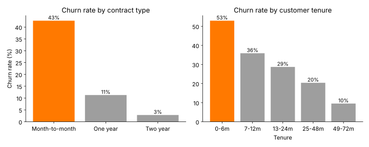
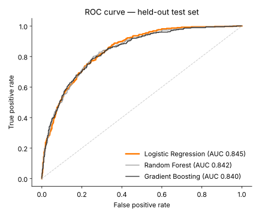
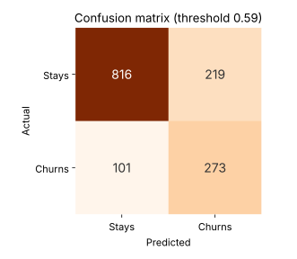
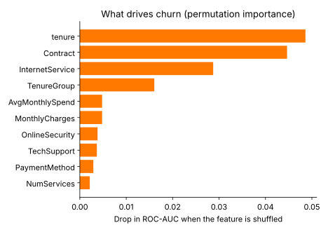

# 📡 Telecom Customer Churn Prediction

An end-to-end machine learning project that predicts which telecom customers are about to cancel their subscription, **explains why** for each customer, and suggests a **retention action**. It is delivered as an interactive Streamlit app for single customers and for whole customer lists.

> **Business result:** if the retention team calls only the **top 20% riskiest customers**, it reaches **50% of all churners**: 2.5× better than calling customers at random.



---

## 🎯 The problem

Acquiring a new telecom customer costs far more than keeping an existing one. With **26.5%** of customers leaving in this dataset, the goal is to:

1. **Predict** each customer's probability of churning
2. **Explain** the main reasons behind each prediction
3. **Prioritise** who the retention team should contact first, and with what offer

## 📊 Results

Three models were compared with 5-fold stratified cross-validation, then evaluated once on a held-out test set (1,409 customers never seen during training).

| Model | CV ROC-AUC | Test ROC-AUC | Test PR-AUC |
|---|---|---|---|
| **Logistic Regression** ✅ | **0.847** | **0.845** | 0.653 |
| Random Forest | 0.844 | 0.842 | 0.656 |
| Gradient Boosting (HistGB) | 0.838 | 0.840 | 0.654 |

**Logistic Regression was selected.** It performed as well as the tree ensembles and is fully interpretable, which matters when a retention agent needs to know *why* a customer is flagged.

Performance of the selected model on the test set, at a decision threshold of **0.59** (tuned on cross-validation predictions, not on the test set):

| Metric | Value |
|---|---|
| Recall: churners caught | **73%** (273 of 374) |
| Precision: flagged customers who really churn | 55% |
| F1-score | 0.63 |
| Churn rate in the top 20% riskiest customers | **67%** (vs. 26.5% overall) |
| Lift in the top 20% | **2.5×** |

<p>


</p>

## 🔍 Key insights



- **Contract type** is the strongest signal: month-to-month customers churn at **43%**, compared with **3%** on two-year contracts.
- **The first 6 months are critical:** **53%** of new customers leave, falling to 10% after 4 years.
- **Fibre-optic** customers churn more than DSL customers, which points to price or service-quality issues.
- Customers **without Online Security or Tech Support**, and those paying by **electronic check**, are at higher risk.

## 🖥️ The app

| Tab | What it does |
|---|---|
| 🔍 **Single customer** | Enter a customer profile → churn probability, risk band, the top factors raising or lowering risk, and suggested retention actions |
| 📂 **Batch scoring** | Upload a CSV of customers → ranked list by risk, downloadable for the retention team |
| 📊 **Model performance** | Metrics, model comparison and charts |

**How the explanation works:** for the logistic regression, each feature's contribution is its coefficient × (the customer's value − the average customer's value), summed over the one-hot columns of each original feature. Positive contributions push the customer towards churning.

## ⚙️ Pipeline

```
Raw data (7,043 customers, 21 columns)
   │
   ├─ Cleaning: blank TotalCharges for new customers → 0
   ├─ Feature engineering:
   │     NumServices      number of add-on services subscribed
   │     AvgMonthlySpend  TotalCharges / tenure
   │     ChargeIncrease   current monthly charge − historical average
   │     TenureGroup      0-6m / 7-12m / 13-24m / 25-48m / 49-72m
   ├─ One-hot encoding + scaling (scikit-learn ColumnTransformer)
   ├─ Class imbalance: class_weight="balanced"
   ├─ Model comparison: 5-fold stratified CV
   ├─ Threshold tuning: best F1 on out-of-fold predictions
   └─ Final evaluation on a held-out 20% test set + permutation importance
```

## ▶️ Run it

```bash
git clone https://github.com/abdullah-asasfeh/telecom-churn-prediction.git
cd telecom-churn-prediction
pip install -r requirements.txt

python train.py          # retrain, compare models, regenerate metrics and charts (~20 s)
streamlit run app.py     # open the app at http://localhost:8501
```

The dataset is downloaded automatically on first run and cached in `data/`. The app trains its model on first launch if `models/` is empty.

## 📁 Project structure

```
app.py                 Streamlit app (single customer, batch scoring, performance)
train.py               model comparison, threshold tuning, evaluation, charts
churn/
  pipeline.py          data loading, feature engineering, model definitions
  predict.py           scoring, per-customer explanations, retention actions
reports/metrics.json   all evaluation results
images/                charts used in this README and the app
requirements.txt
```

## 🛠️ Tech stack

Python · pandas · NumPy · scikit-learn (Logistic Regression, Random Forest, HistGradientBoosting, permutation importance) · Matplotlib · Streamlit

## ⚠️ Limitations and next steps

- The data is a public IBM sample of 7,043 customers from one point in time. Real churn models use usage logs, complaints and network-quality data over time.
- The retention actions are rule-based suggestions tied to the risk factors, not learned from campaign results.
- Next steps: add call-centre and network-quality features, estimate the expected revenue saved per retention call, and monitor the model for drift.

## 📚 Data

[IBM Telco Customer Churn](https://github.com/IBM/telco-customer-churn-on-icp4d): 7,043 customers with demographics, subscribed services, contract and billing information, and whether they left in the last month.

---

Developed by **Abdullah Asasfeh**, AI & Data Science graduate
